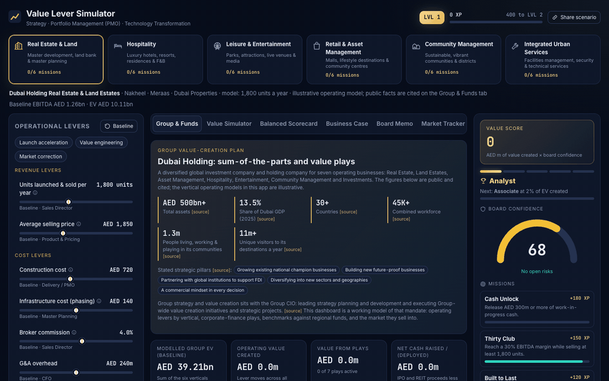
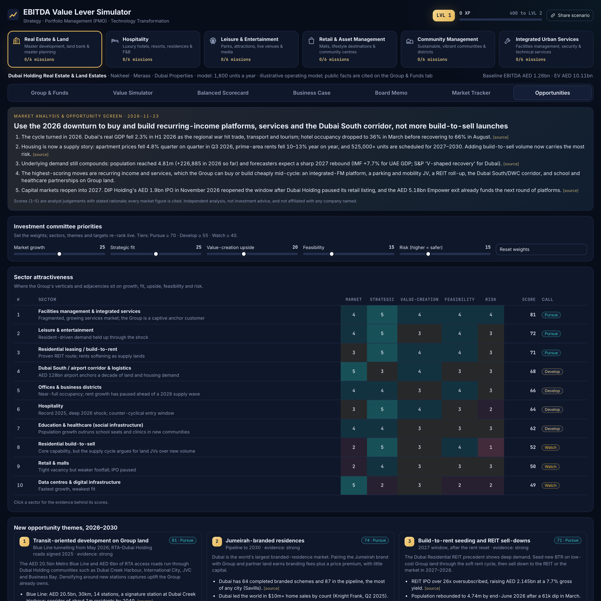
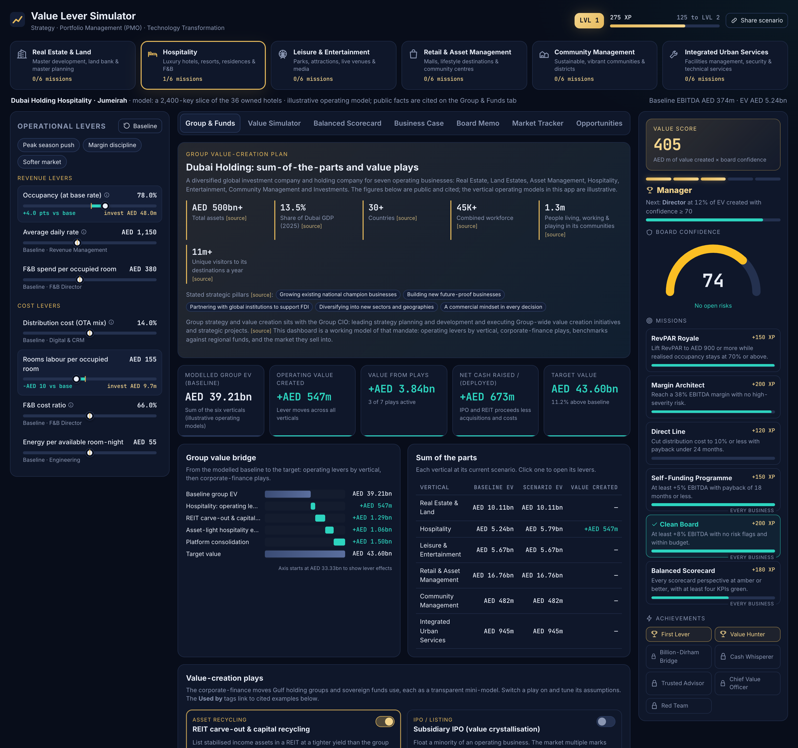
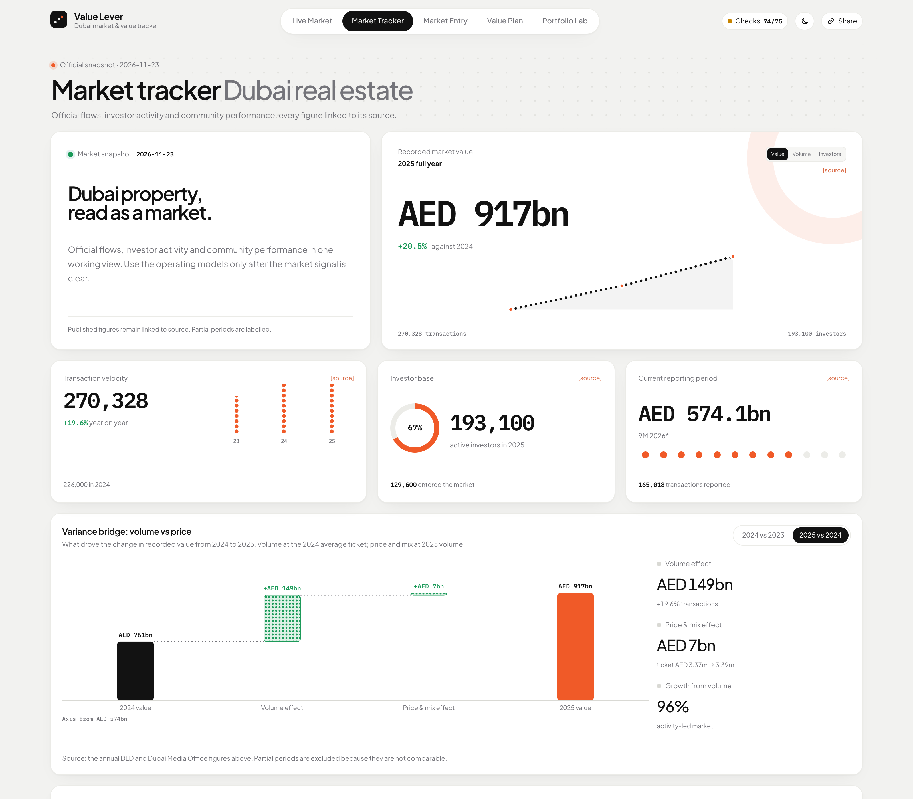
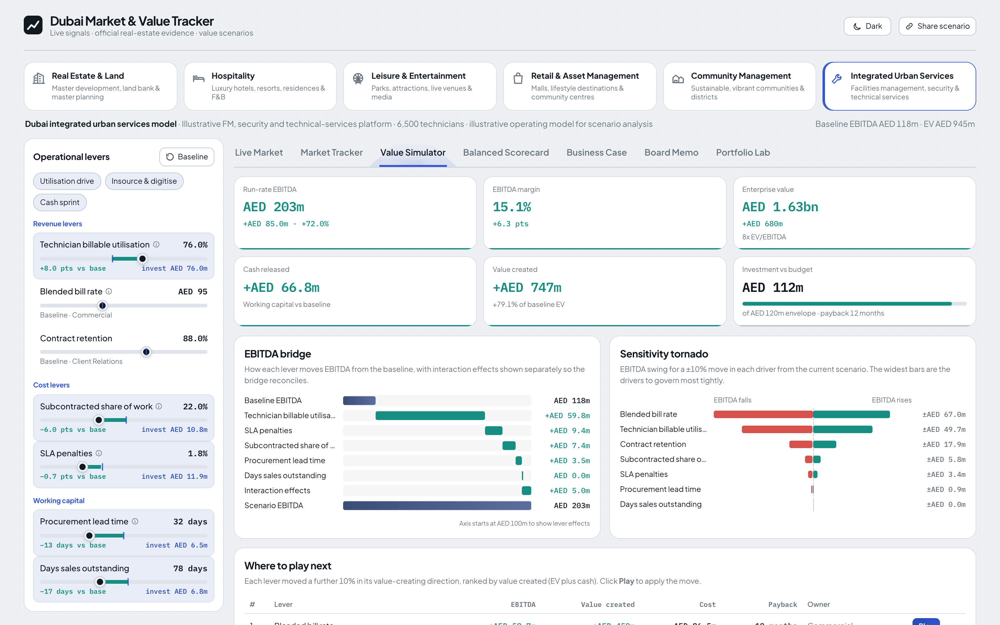
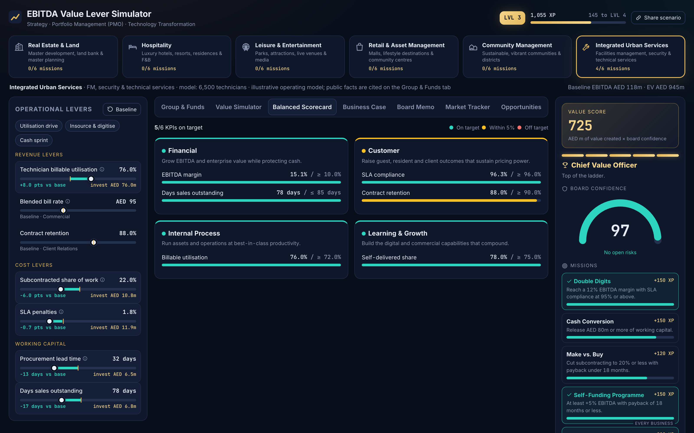
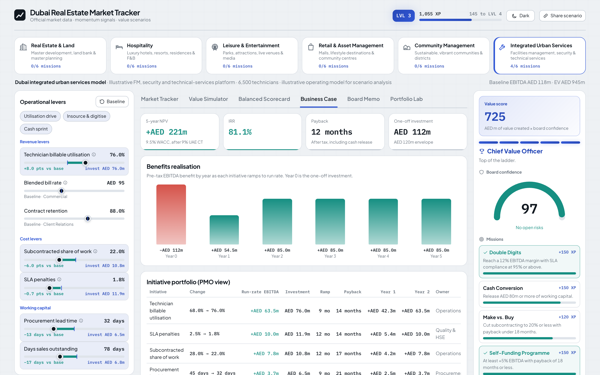
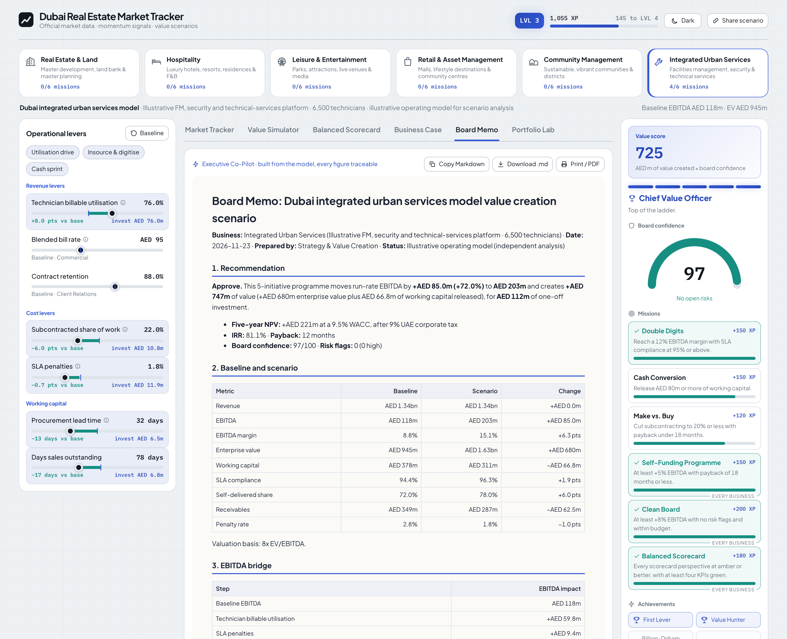

# Value Lever Simulator

**A working model of a Group Strategy & Value Creation mandate: operating levers across Dubai Holding's verticals, the corporate-finance plays the Gulf's largest investors use, cited benchmarks, and an official-data Dubai real-estate market tracker.**

[](https://github.com/Pemalahmad/ebitda-value-lever-simulator/actions/workflows/ci.yml)


**[▶ Open the live simulator](https://pemalahmad.github.io/ebitda-value-lever-simulator/)**



## New: Market Pulse, the investment manager's morning read

**[How it works →](docs/market-pulse.md)**

The landing tab answers four questions before the investment committee: **what moved, what it means for a Dubai portfolio, what the local papers are saying, and was my last call right?**
- **Top signals** ranked Act now / Watch / Tailwind: oil, US rates through the dirham peg, the dollar, volatility, UAE vs US equities, Emaar, freight, and news clusters on Hormuz, the Red Sea and Suez and on regional security.
- **Markets:** DFM, Tadawul, MSCI UAE and Dubai bellwethers, global indices, commodities, FX, rates and freight.
- **Trade, maritime and logistics**, **country movement**, and **news by theme** (resilience, security, economy, resources, infrastructure, society) from Gulf News, The National, Khaleej Times, WAM, Zawya, Arabian Business and the maritime press.
- **Decision journal:** thesis, what would change your mind, linked signals, a pre-commitment checklist and a review date, with market levels saved so each review shows what has moved since.
- Refreshed every 6 hours by CI from delayed prices and headlines. Not investment advice.


## Market analysis and opportunity screen

**[Read the analysis →](docs/market-opportunity-analysis.md)**

> **Use the 2026 downturn to buy and build recurring-income platforms, services and the Dubai South corridor, not more build-to-sell launches.**

The **Opportunities** tab:
- ranks **10 sectors**, **13 themes for 2026–2030** and **19 companies** (listed and private) on growth, strategic fit, upside, feasibility and risk;
- lets you set the investment committee's weights with sliders, and re-ranks live;
- links every market figure to its source;
- offers **Model it** on each target, which loads the matching value play (acquisition, land JV, platform, asset-light).



The **Market Tracker** now covers what the popular DLD dashboards show, from official data:
- AED/USD/EUR/GBP switching;
- a 2021–2025 price-per-m² trend;
- splits by transaction type and by ready/off-plan/land;
- investor origin by region;
- the top rental communities;
- a **fair-value check** ("is this asking price above market?"), built on transacted prices rather than scraped listings.

With an ingested DLD CSV it adds filterable transaction records, top deals, price by bedrooms, price bands, a 7-day trend, the off-plan premium, and area price drops and increases.

## Group & Funds and Market Tracker

- **Group & Funds tab**: Dubai Holding's public profile (AED 500bn+ assets, 13.5% of Dubai GDP, its seven operating businesses and stated strategic pillars), every figure linked to its source. A **sum-of-the-parts** of the six modelled verticals feeds a **group value bridge**.
- **Seven value-creation plays**, each a transparent mini-model you can switch on and tune: REIT carve-out and capital recycling, subsidiary IPO, land-bank JV, asset-light hospitality expansion, platform consolidation, bolt-on M&A, and master-planned destination launch.
- **What Dubai Holding is actually doing**: 12 cited moves from 2024–2026 (Nakheel/Meydan integration, Palm Jebel Ali, the Dubai Residential REIT IPO, the Aldar JV, the Empower divestment, the Emaar stake, Palm Springs and more). **Model it** loads the matching play; the REIT preset reproduces the AED 2.1bn the IPO raised.
- **Regional fund benchmark**: PIF, ADIA, ICD, Mubadala, QIA and L'imad/ADQ, with AUM (and its basis), mandate and recent moves, plus a playbook matrix showing who uses which value lever.
- **Market Tracker tab**: official DLD and Dubai Media Office figures (2023–2025 totals, Q1 2026, top communities by investment value, prices, rents, off-plan share, Strategy 2033 and Dubai 2040 targets), each with its source. It also includes a **DLD open-data ingest** (`scripts/ingest-dld.mjs`) that adds a deal-level tracker: monthly flow, top projects, and area **price drops and increases** (median AED/m², latest 90 days vs the 90 before).

> **Independent analysis.** Not affiliated with or endorsed by Dubai Holding, DLD or any fund named. Public figures are cited; the vertical operating models are illustrative. AUM figures use different bases (self-reported, audited total assets, or Global SWF estimates), and each one is labelled.





## The problem

Leadership teams struggle to say what *"cut churn by 1.5 points"*, *"shorten procurement lead times"* or *"lift utilisation"* is worth in EBITDA and valuation, or what it puts at risk. The answer is usually spread across a spreadsheet, a slide deck and a risk register that never meet.

This simulator puts them in one place. Each slider is a real operating KPI. Every move flows through a driver-based P&L to EBITDA, enterprise value and cash, and it is checked against a Balanced Scorecard and a library of operating risks. An Executive Co-Pilot then writes the board memo.

## What it covers

It models **six Dubai Holding verticals** with illustrative operating economics, each with its own driver tree:

| Business | Example levers | Valuation |
|---|---|---|
| Real Estate & Land | sales velocity, price/sqft (elasticity −1.1), construction cost, infrastructure phasing, broker commission, construction cycle | 8x EBITDA |
| Hospitality | occupancy, ADR (elasticity −0.6), F&B spend, OTA distribution cost (CAC), rooms labour, F&B cost ratio, energy | 14x EBITDA |
| Leisure & Entertainment | marketing spend (diminishing returns), CAC, annual-pass retention, ticket yield, per-cap spend, staffing (capacity-capped) | 11x EBITDA |
| Retail & Asset Management | occupancy, base rent, footfall, turnover rent, service-charge recovery, opex/sqm, tenant retention | NOI at 7.25% cap rate |
| Community Management | management fee (RERA approval), collection rate, amenity income, contract retention, procurement savings, self-service adoption | 10x EBITDA |
| Integrated Urban Services (FM) | technician utilisation, bill rate, make-vs-buy subcontract share, SLA penalties, procurement lead time, DSO | 8x EBITDA |

## How it maps to a Strategy & Value Creation role

| Responsibility | Where it lives in the app |
|---|---|
| Strategic planning and the **Balanced Scorecard** cycle | *Balanced Scorecard* tab: four perspectives, KPIs with targets, RAG status that moves with every lever |
| **Financial models, scenarios and business cases**, and tracking benefits through to execution | Driver-based P&L per business; *Business Case* tab with NPV, IRR, payback after 9% UAE corporate tax, ramp-up phasing and a PMO initiative register with owners |
| **KPI dashboards**, performance reports and **executive presentations** | *Value Simulator* tab: EBITDA bridge, sensitivity tornado, two-way heatmap, P&L variance. *Board Memo* tab: an answer-first memo, exportable to Markdown or PDF |
| Evaluating commercial opportunities | *Where to play next* ranks every lever by value created per move, cost and payback |
| Risk governance | Each business has risk flags for levers pushed too far (service standards, tenant affordability, SLA burnout, regulatory approval), each with a mitigation and an owner |
| Strategy, **PMO** and **Technology Transformation** pillars | Digital levers (CRM/direct booking, CAFM predictive maintenance, resident self-service) sit next to commercial and operational ones |

## The game layer

The game makes the trade-offs easy to feel. It does not reward big numbers on their own:

- **Value score** = AED value created × *board confidence*. Pushing a lever into a risk zone, going over the transformation budget or turning the scorecard red all cost confidence.
- **Ranks**: Analyst → Associate → Manager → Director → Chief Value Officer. The top ranks need both value created (as a share of EV) and board confidence.
- **Missions**: three per business plus three that apply everywhere (*Self-Funding Programme*, *Clean Board*, *Balanced Scorecard*). They earn XP and levels.
- **Achievements** persist in your browser across businesses.
- **Play** buttons apply the next-best 10% move in one click. Every scenario has a shareable URL.

| Simulator | Balanced Scorecard |
|---|---|
|  |  |
| **Business case** | **Board memo** |
|  |  |

## Executive Co-Pilot (the board memo)

The memo is generated **deterministically from the model**, so every figure can be traced to the engine and none is invented. It follows the Pyramid Principle and leads with the answer:

1. **Recommendation**: Approve / Approve with conditions / Do not approve, with value, NPV, IRR, payback, confidence and budget
2. Baseline vs scenario (P&L and operating KPIs)
3. EBITDA bridge, with the *so what*
4. Highest-leverage value drivers and sensitivity
5. Trade-offs and risks, with mitigation and owner
6. Balanced Scorecard impact
7. Benefits realisation plan (year 1–3 phasing, owners, governance cadence)
8. Decisions requested

It is available in the UI, from the API (`POST /api/memo`) and from the CLI.

## Quick start

```bash
git clone https://github.com/Pemalahmad/ebitda-value-lever-simulator.git
cd ebitda-value-lever-simulator
npm install
npm run dev          # dashboard at http://localhost:5173
npm test             # 45 tests: engine, plays, DLD ingest, opportunity data, API, CLI
```

Serve the built dashboard and the JSON API from Node:

```bash
npm run build && npm start      # http://localhost:8787
curl -s localhost:8787/api/sectors | head -c 300
curl -s -X POST localhost:8787/api/simulate \
  -H 'content-type: application/json' \
  -d '{"sector":"urbanServices","levers":{"utilisation":75,"dso":80}}'
```

Write a board memo from the command line:

```bash
node bin/value-memo.js --list
node bin/value-memo.js --sector hospitality --set occupancy=78,labourPOR=152 > memo.md
node bin/value-memo.js --sector retail --scenario "Destination upgrade" --summary
node bin/value-memo.js --sector urbanServices --file data/scenarios/fm-utilisation-and-cash.json
```

Turn a DLD open-data CSV into the deal-level market tracker:

```bash
# dubailand.gov.ae → Open Data → Real Estate Data → Transactions → Download as CSV
node scripts/ingest-dld.mjs ~/Downloads/transactions.csv   # writes data/market/dld-aggregate.json
npm run build
```

## Architecture

```
src/engine/            pure JavaScript, zero dependencies; runs in the browser and in Node
  sectors/*.js         six driver trees: levers, P&L, KPIs, risk flags, scorecard, missions
  model.js             levers → P&L → EBITDA → EV, investment, comparison vs baseline
  analysis.js          EBITDA bridge, tornado, leverage ranking, two-way grid
  businessCase.js      initiative phasing, NPV, IRR, payback (UAE CT 9%)
  scorecard.js         Balanced Scorecard RAG
  game.js              board confidence, ranks, missions, achievements
  memo.js              Executive Co-Pilot board memo (Markdown)
  plays.js             seven group-level value-creation plays (REIT, IPO, JV, asset-light, platform, M&A, master plan)
  market.js            DLD transactions CSV parser + market aggregation (momentum, bedrooms, bands, trend, records)
  opportunities.js     weighted multi-criteria scoring for sectors, themes and targets
data/benchmarks/       Dubai Holding facts and moves, regional fund benchmark (every figure sourced)
data/market/           official DLD aggregates (+ optional ingested deal-level aggregate)
data/opportunities/    cited market analysis, themes and target screen
src/ui/                React dashboard with hand-built SVG charts and no chart library
server/index.js        zero-dependency Node HTTP server: static app + JSON API
bin/value-memo.js      CLI memo generator
tests/                 node:test suites for engine invariants, API and CLI
```

The same engine powers the UI, the API and the CLI, so a number on screen, in the API and in the memo always comes from the same code.

## Documentation

- [User guide](docs/user-guide.md): a five-minute walkthrough
- [Methodology](docs/methodology.md): every formula, elasticity, valuation basis and the business-case maths

## Roadmap

This repo is the first of a planned series of operations-strategy tools:

- **Margin-leakage triage agent**: ingest messy refunds, tickets and invoices, classify failure modes, and output a Pareto action plan with ROI per fix
- **Automated DLD refresh** through the data.dubai API once a key is registered
- **Supply-chain war-gaming engine**: stress-test a bill of materials or vendor base for single points of failure and working-capital shocks
- **SOP-to-workflow process mining kit**: compare SOPs with event logs and generate a to-be process map in Mermaid
- **Ops-strategy skills library**: constraint auditor, make-vs-buy engine, PMI synergy tracker, 100-day plan generator
- In this app: an ERP/CSV import to replace the illustrative baselines with real ones, and a Monte Carlo range on top of the deterministic case

## Disclaimer

Public figures are taken from the sources linked next to them, as of November 2026. The **vertical operating models (levers, P&L lines, costs) are illustrative**: they are calibrated to be plausible, not taken from Dubai Holding's accounts, which are not public at the vertical level. Independent analysis; not affiliated with or endorsed by any organisation named; not investment advice.

## License

[MIT](LICENSE)
