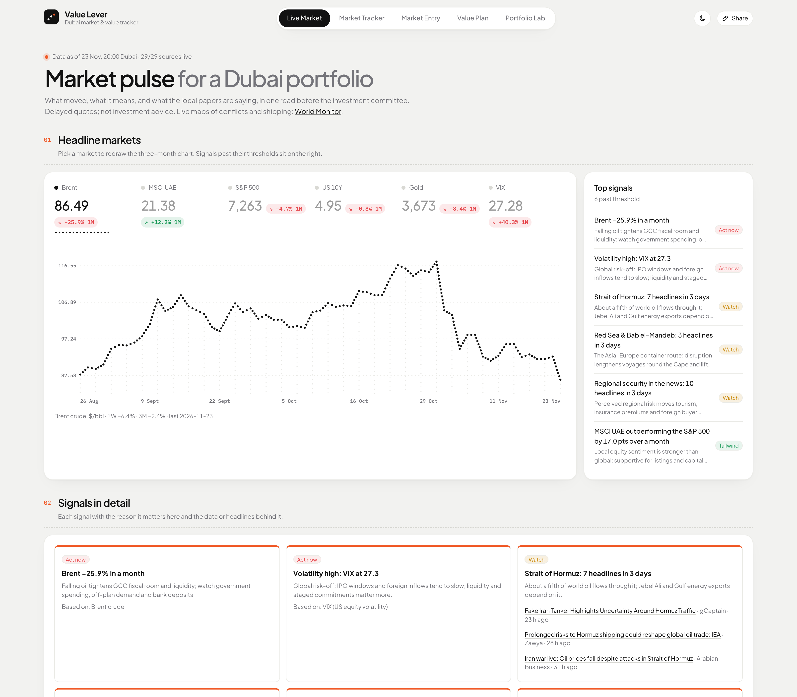
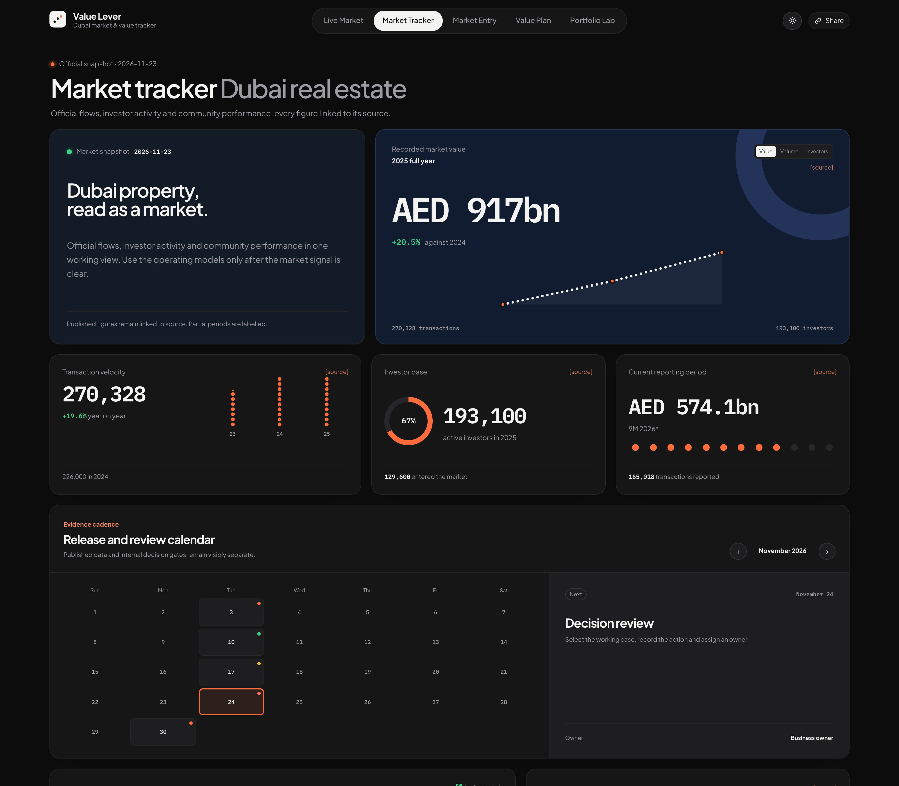
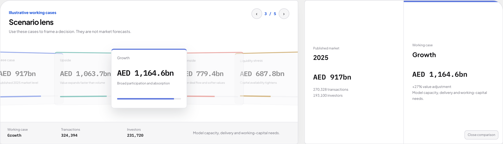
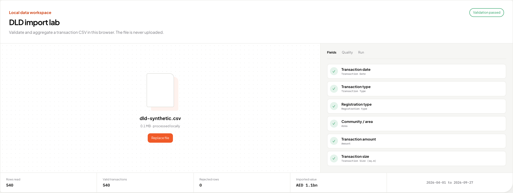
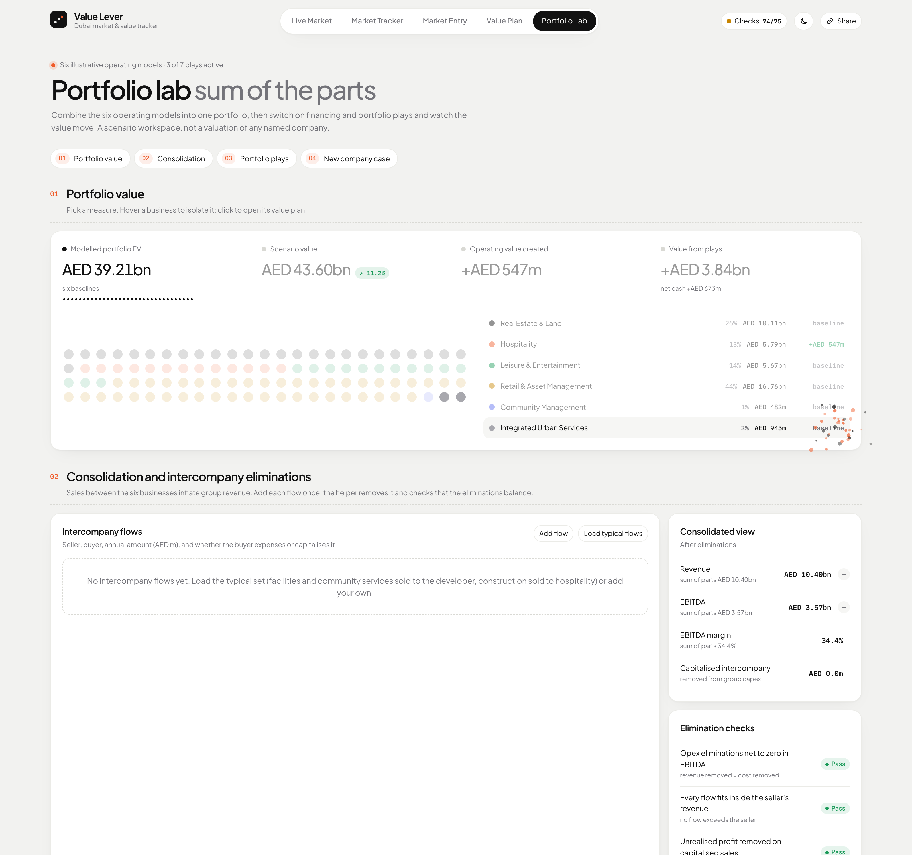

# Dubai Market & Value Tracker

**Independent Dubai market intelligence built from cited public sources and open transaction data, with scenario tools that connect market movement to operating and portfolio value.**

[](https://github.com/Pemalahmad/ebitda-value-lever-simulator/actions/workflows/ci.yml)


**[▶ Open the live tracker](https://pemalahmad.github.io/ebitda-value-lever-simulator/)**


## Live Market — UAE investment read

The **Live Market** workspace adds a six-hour market and news pulse without tying the analysis to a named organisation. It includes:

- urgency-ranked market signals with their evidence;
- Dubai, GCC and global market tables with source-recency warnings;
- oil, rates, currencies, volatility, freight and maritime chokepoints;
- country and theme filters for linked news headlines;
- a browser-local decision journal with review dates and an evidence checklist;
- explicit source-health and fallback-data status.



## What it tracks

The market tracker is the default landing experience. It brings together:

- annual Dubai transaction value, volume and investor participation;
- current-period transaction value and volume;
- leading communities by investment value;
- cited market signals covering sales, off-plan share, prices, rents and long-term demand;
- an interactive history chart that switches between value, transactions and investors, with period-level inspection;
- a morphing headline instrument for value, volume and investor participation;
- an evidence calendar for market releases, review dates and decision gates;
- five illustrative working cases in an interactive scenario deck, linked to a folding before/after comparison;
- a persistent light/dark theme switch;
- a four-stage market-signal SOP that tracks validation, materiality, response and decision-record gates;
- a mobile command dock for jumping between market workspaces;
- a browser-based DLD import lab that validates and aggregates a Transactions CSV locally, without uploading it;
- deal-level analysis from the connected CSV, including monthly flow, median AED/m², off-plan share, price momentum and top projects.

Every published headline links to its source. The snapshot date is visible in the product, and partial-period figures are labelled.







## From market signal to value scenario

The tracker also includes six illustrative operating models for testing how market conditions may affect value:

| Model | Representative drivers |
|---|---|
| Real Estate & Land | launch volume, selling price, construction cost, infrastructure phasing, commission, cycle time |
| Hospitality | occupancy, ADR, distribution cost, labour, F&B margin, energy |
| Leisure & Entertainment | visits, yield, marketing, retention, safety staffing, ancillary spend |
| Retail & Asset Management | occupancy, rent, footfall, turnover rent, recoveries, operating cost |
| Community Management | fees, collections, retention, service cost, procurement, digital adoption |
| Integrated Urban Services | utilisation, bill rate, retention, subcontracting, SLA penalties, DSO |

Move a lever and the application recalculates EBITDA, enterprise value, working capital, one-off investment, NPV, IRR, payback, risk flags, a Balanced Scorecard and a board memo. The **Portfolio Lab** combines the six model outputs into a sum-of-the-parts scenario and adds seven transparent portfolio plays.

> The operating models are illustrative. They are not company forecasts, investment recommendations or valuations of a named organisation.



## Quick start

```bash
git clone https://github.com/Pemalahmad/ebitda-value-lever-simulator.git
cd ebitda-value-lever-simulator
npm ci
npm run dev
```

Open the local URL shown by Vite. The market tracker appears first; use the tabs to open the scenario tools.

Refresh the committed Live Market snapshot with `npm run pulse`. The scheduled GitHub workflow refreshes it every six hours before deployment and retains the last good value when a source is temporarily unavailable.

### Production build

```bash
npm run check
npm start
```

`npm run check` runs the complete Node test suite and creates the static production build in `dist/`. The included Node server serves that build and the JSON simulation API.

## Connect DLD transaction data

The repository ships with cited published aggregates in `data/market/dld-official.json`. To enable deal-level momentum analysis:

1. Download the Transactions CSV from [DLD Open Data](https://dubailand.gov.ae/en/open-data/real-estate-data/).
2. Run:

   ```bash
   node scripts/ingest-dld.mjs /path/to/transactions.csv
   ```

3. Rebuild the application:

   ```bash
   npm run build
   ```

The import lab can read the same file directly in the dashboard and keeps it in the browser session. For a repeatable bundled build, the ingest script writes `data/market/dld-aggregate.json`. Neither route uploads the source CSV or requires a third-party data service.

## Share a scenario

Scenario state is encoded in the URL hash. A shared link carries the selected model, view and changed levers without sending the scenario to a backend.

```text
#tab=market
#s=realEstate&tab=simulator&units=2200&price=1900&cycle=26
#s=hospitality&tab=case&occupancy=80&adr=1220
```

## CLI and API

Generate a decision memo without the browser:

```bash
npm run memo -- --sector hospitality --scenario "Peak season push"
npm run memo -- --sector realEstate --set units=2200,price=1900,cycle=26 --summary
```

After `npm run build && npm start`, the local API provides:

- `GET /api/health`
- `GET /api/sectors`
- `POST /api/simulate`
- `POST /api/sensitivity`
- `POST /api/memo`

## Repository map

```text
src/engine/             deterministic calculation engine
src/engine/sectors/     six illustrative operating models
src/ui/                 React tracker and scenario workspace
data/market/            cited market snapshot and optional generated aggregate
scripts/ingest-dld.mjs  local DLD CSV ingestion
server/                 static server and simulation API
bin/                    board-memo CLI
tests/                  engine, market, API and security tests
docs/                   methodology, user guide and product images
```

## Method and limitations

- Market headlines are hand-curated from the sources linked in `data/market/dld-official.json`.
- Deal-level momentum uses median sale AED/m² in the latest 90 days versus the preceding 90 days, with a minimum transaction threshold.
- Operating baselines, elasticities, costs and valuation assumptions are illustrative and deterministic.
- The model does not forecast the market and does not replace source-data validation, professional valuation or investment due diligence.

See [docs/methodology.md](docs/methodology.md) for formulas and [docs/user-guide.md](docs/user-guide.md) for the workflow.

## License and independence

MIT licensed. Independent analysis; not affiliated with or endorsed by Dubai Land Department or any source publisher. This project is not investment advice.
