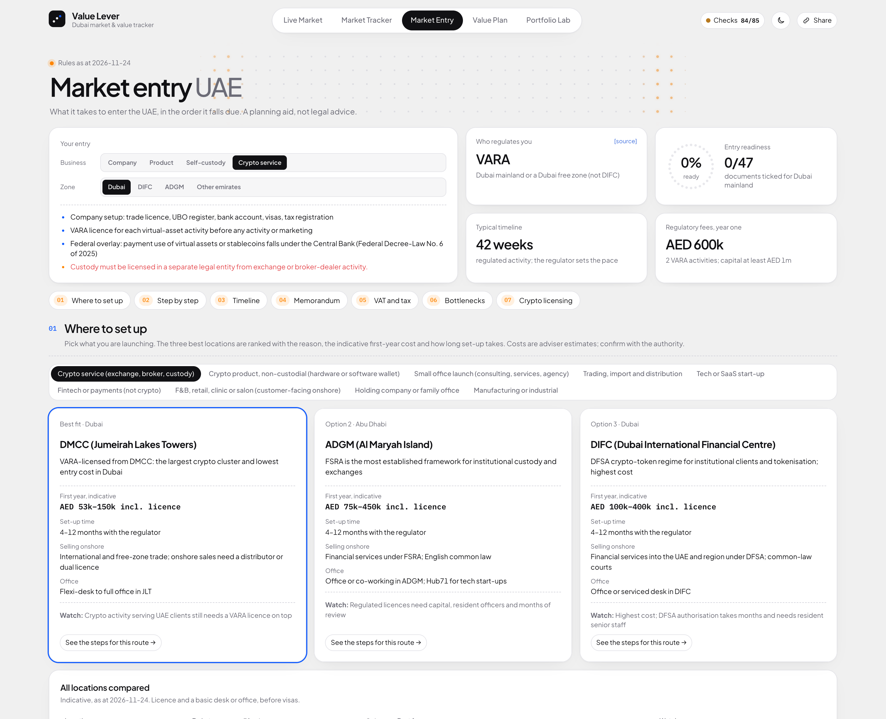
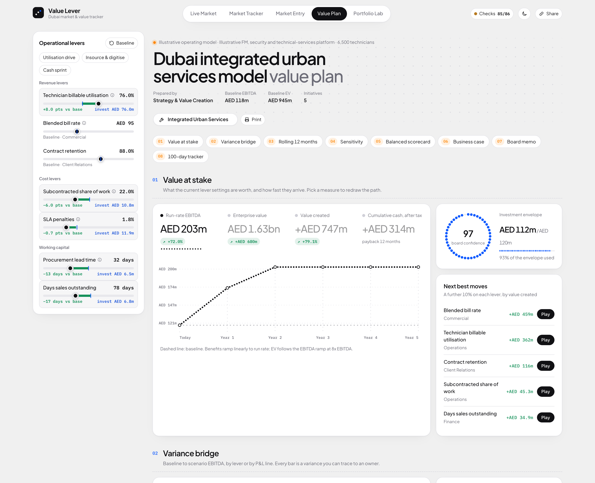
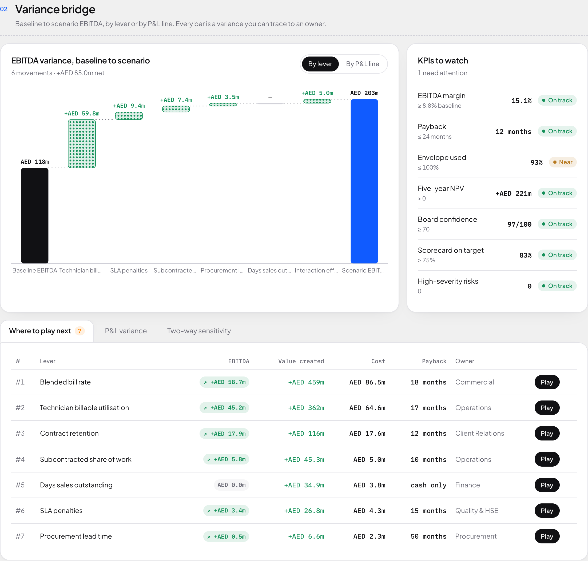
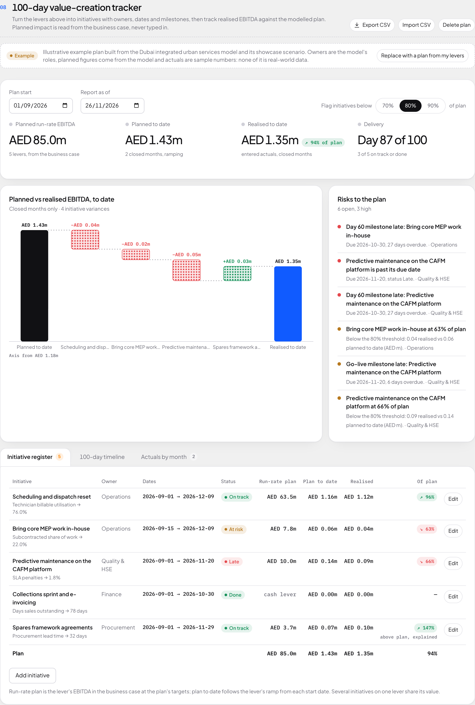
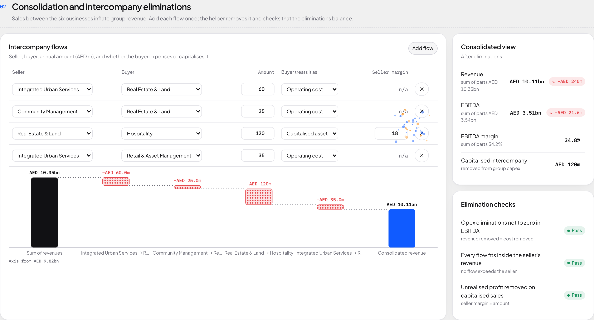
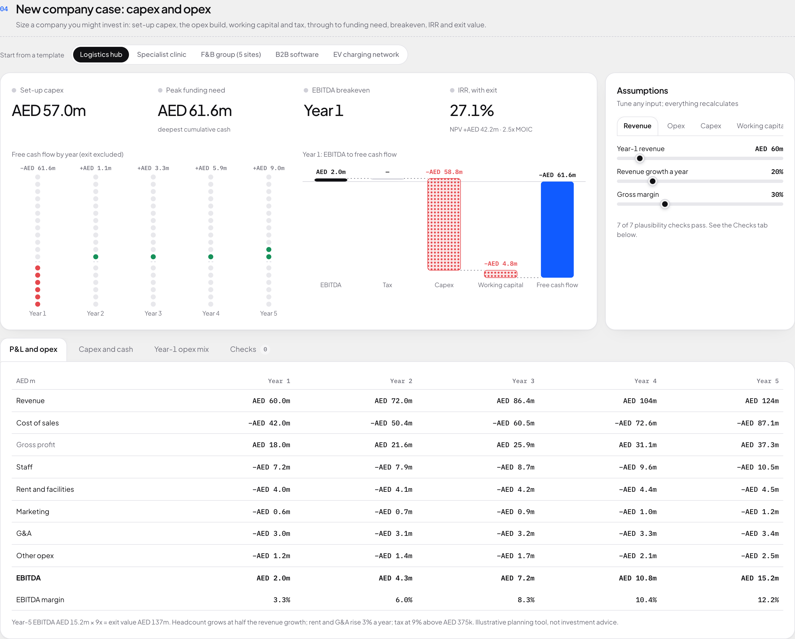
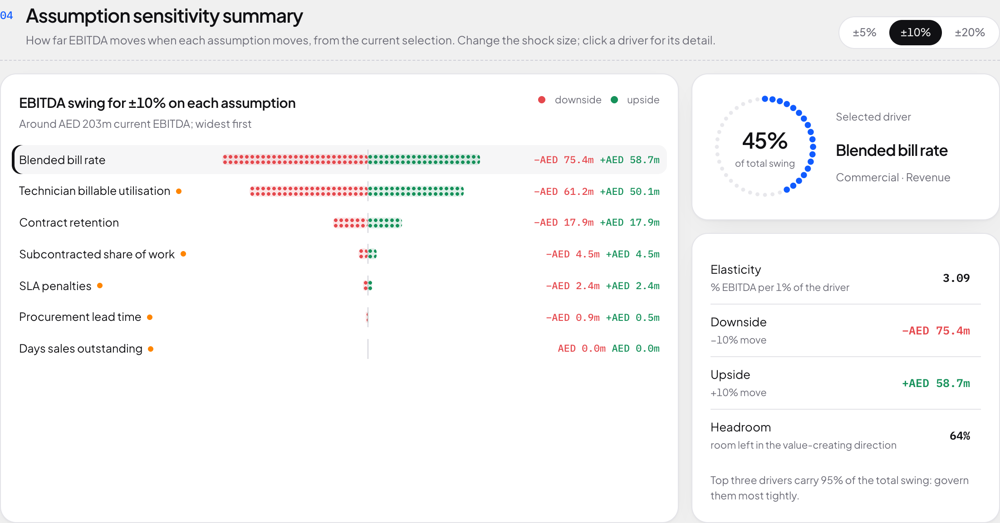
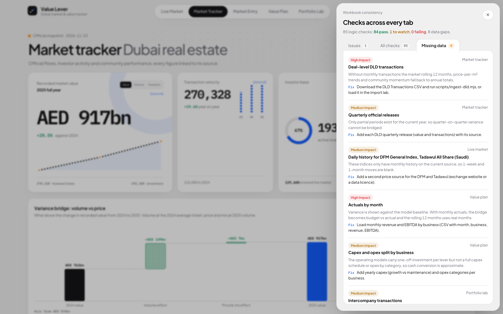

# Value Lever — Dubai Market & Value Tracker

**A decision workspace for investing and creating value in Dubai: live market signals, official real-estate evidence, a UAE market-entry roadmap, operating value plans and a portfolio lab, all in one consistent design and every figure traceable to its source or its formula.**

[](https://github.com/Pemalahmad/ebitda-value-lever-simulator/actions/workflows/ci.yml)


**[▶ Open the live app](https://pemalahmad.github.io/ebitda-value-lever-simulator/)**


---

## Contents

1. [What it does](#what-it-does)
2. [The five tabs](#the-five-tabs)
3. [Analysis toolkit](#analysis-toolkit)
4. [Data and sources](#data-and-sources)
5. [Quick start](#quick-start)
6. [Share links, CLI and API](#share-links-cli-and-api)
7. [How it is built](#how-it-is-built)
8. [Method and limitations](#method-and-limitations)

---

## What it does

An investment or strategy team in Dubai needs answers to five questions. Each tab answers one of them.

| Tab | The question it answers | Key tools |
|---|---|---|
| **Live Market** | What moved, and does it matter for a Dubai portfolio? | Headline chart, KPIs to watch with triggers, signal register, markets, shipping chokepoints, local news by theme, decision journal |
| **Market Tracker** | How is Dubai real estate actually performing? | Official DLD value, volume and investors, volume-vs-price variance bridge, community ledger, scenario deck, DLD import lab |
| **Market Entry** | What does it take to enter the UAE? | Regulator routing, company set-up procedure, VARA licensing stages, capital and fee calculator, cash-before-launch waterfall |
| **Value Plan** | What is a business worth if we pull these levers? | EBITDA variance bridge, KPIs to watch, rolling 12 months, assumption sensitivity, balanced scorecard, business case, board memo, 100-day value-creation tracker |
| **Portfolio Lab** | What is the group worth, and what would a new company add? | Sum of the parts, intercompany eliminations, portfolio plays, new-company capex and opex case |

A **Checks** button in the top bar runs 85 consistency checks across all five tabs and lists the data that is still missing.

## The five tabs

### Live Market

Refreshed every six hours from 29 sources: delayed prices plus local and maritime news.

- **Headline chart:** switch between Brent, MSCI UAE, S&P 500, US 10-year yield, gold and VIX; hover for the exact value and date.
- **KPIs to watch:** every signal threshold, how close each market is to it, and its status. Upside moves in UAE equities show as a tailwind, not a breach.
- **Signal register:** each signal past its threshold, listed once. Open a row for the headlines behind it.
- **Markets** by group under folder tabs, **shipping chokepoints** (Hormuz, Red Sea, Suez), **country movement**, and **news by theme**: resilience, security, economy, resources, infrastructure and society.
- **Decision journal:** record the thesis, what would change your mind and a review date. Market levels are saved with each note.


### Market Tracker

Official DLD and Dubai Media Office figures, each linked to its source.

- **Headline figures:** annual value, transactions and investors, and the current reporting period.
- **Variance bridge:** how much of each year's change came from more deals and how much from a higher average ticket. In 2025, 96% of the AED 156bn growth came from volume.
- **History chart, community ledger, release calendar, scenario deck and before/after comparison.**
- **DLD import lab:** validates and aggregates a Transactions CSV in the browser, without uploading it.


### Market Entry

A step-by-step UAE entry roadmap for any business, with a full track for virtual-asset (crypto) firms benchmarked on Dubai's VARA and its ADGM and DIFC equivalents.

- **Where to set up:** pick what you are launching (crypto, small office, trading, tech, fintech, onshore retail, holding, industrial). The three best locations come ranked, with reasons, indicative cost and set-up time.
- **Step by step for your route:** Dubai mainland, a Dubai free zone, Abu Dhabi mainland, ADGM or DIFC. Fourteen steps, each with the platform to use (Invest in Dubai, TAMM, Ejari, Tawtheeq, EmaraTax, GDRFA, ICP, MoHRE and others), documents, indicative cost, time, bottleneck and tip.
- **Timeline** with the critical path; a **memorandum of association guide** (clauses, execution, templates); **VAT and corporate tax** rules and what the EmaraTax application asks for; **compliance bottlenecks** with fixes.
- **Entry profile:** the business model and zone pick the regulator (VARA, DFSA, FSRA or SCA) and flag traps, such as custody needing its own entity.
- **Procedure:**
  - company set-up, product import and a self-custody licence map;
  - VARA's two licensing stages, each with what to file and what is and is not allowed;
  - every step has a checklist.
- **Capital and fee calculator** across VARA's eight activities, with a **waterfall** of the cash needed before the first client.
- **Compliance, pitfalls and sources.**

Details: [docs/market-entry.md](docs/market-entry.md). A planning aid, not legal advice.



### Value Plan

Six illustrative operating models: real estate, hospitality, leisure, retail and asset management, community management, and integrated urban services. Move the levers on the left and an eight-section document recalculates.

1. **Value at stake:** five-year path of EBITDA, EV, value created or cash, with board confidence and the next best moves.
2. **Variance bridge:** baseline-to-scenario EBITDA as a waterfall, by lever or by P&L line, beside the **KPIs to watch**.
3. **Rolling 12 months:** trailing-twelve-month EBITDA as initiatives ramp, and the month 90% of the uplift is banked.
4. **Assumption sensitivity summary:** downside and upside swing per assumption at ±5%, ±10% or ±20%, with share of total risk, elasticity and headroom.
5. **Balanced scorecard:** a ring per perspective and each KPI against its target.
6. **Business case:** NPV, IRR and payback after 9% UAE corporate tax, yearly benefits and cumulative cash.
7. **Board memo:** the decision on one page (verdict, value by initiative, risks, decisions requested). The full written memo is one click away.
8. **100-day value-creation tracker:** the selected levers become an execution plan. Each initiative has a linked lever, an owner, start and due dates, Day 30/60/100 milestones and a status (Not started, On track, At risk, Late, Done).
   - **Planned impact is never typed in.** It is the lever's run-rate EBITDA from the business case at the plan's lever targets, phased day by day along the lever's ramp from each initiative's start date.
   - **Realised impact** is entered as actuals for each closed month.
   - **Views:** an initiative register, a 100-day timeline, a planned-vs-realised EBITDA bridge (the same waterfall as the variance bridge) and a short list of risks to the plan: late milestones, past-due work and initiatives below 70%, 80% or 90% of plan.
   - **Storage:** plans stay in this browser (localStorage), one per business, with CSV export and import.
   - **Example plan:** a first visit opens a clearly labelled example built on the illustrative integrated urban services model. Its owners are model roles and its actuals are sample numbers.







### Portfolio Lab

- **Portfolio value:** each dot is 1% of portfolio EV. Hover a business to isolate it, click to open its value plan. Switch to the value bridge, the operating value or the plays.
- **Consolidation:** an intercompany elimination helper with balance checks.
- **Portfolio plays:** seven transparent corporate-finance plays (REIT carve-out, subsidiary IPO, land-bank JV, asset-light hospitality, platform consolidation, bolt-on M&A, master-planned launch). A **live-impact panel beside the cards** redraws its waterfall, scenario value and net cash the moment a play is switched on or a slider moves.
- **New company case:** a capex and opex calculator for a company you might invest in.


## Analysis toolkit

### Variance bridges on every tab

Every bridge reconciles exactly (start + steps = end), and the checker tests it on every change.

| Where | Bridge |
|---|---|
| Market Tracker | Recorded value, year on year: volume effect vs price and mix effect |
| Market Entry | Cash before the first client: application fees, supervision, paid-up capital |
| Value Plan | EBITDA, baseline to scenario, by lever or by P&L line |
| Portfolio Lab | Portfolio value by business and play; consolidated revenue after eliminations |
| New company case | Year-1 EBITDA to free cash flow: tax, capex, working capital |

### Intercompany eliminations

Sales between the six businesses inflate group revenue. Enter each flow once (seller, buyer, amount, and whether the buyer expenses or capitalises it).

- **Operating flows:** revenue and cost both fall, so EBITDA is unchanged.
- **Capitalised flows:** the seller's margin is removed as unrealised profit.
- **Checks:** opex eliminations net to zero, and no flow exceeds the seller's revenue.



### New company case: capex and opex

Five editable templates: logistics hub, specialist clinic, F&B group, B2B software and EV charging network.

- **Inputs:**
  - revenue and growth, gross margin;
  - overhead headcount and cost per head;
  - rent, marketing, G&A;
  - set-up capex by type, asset life and maintenance capex;
  - working-capital days, discount rate and exit multiple.
- **Outputs:**
  - peak funding need, EBITDA breakeven and payback;
  - NPV, IRR and MOIC with a year-5 exit;
  - a five-year P&L and cash flow, and the year-1 opex mix;
  - plausibility checks.



### Assumption sensitivity summary



### Workbook checks and missing data

The **Checks** button runs 85 checks.

- **Operating models:**
  - lever ranges and scenario presets;
  - P&L lines adding up to EBITDA, and valuation;
  - both bridges reconciling and NPV recomputing;
  - rolling 12 months converging, margins and budget.
- **100-day tracker (per saved plan):**
  - every initiative is linked to a lever, and every planned lever has an initiative;
  - start, due and milestone dates in order;
  - planned impact equals the modelled lever value, and the planned-vs-realised bridge reconciles;
  - realised never exceeds plan without a recorded explanation;
  - actuals only for closed months, an owner for every initiative, status consistent with dates, and plan targets matching the Value Plan levers.
- **Portfolio plays:** each play's value equals its lines.
- **Market data:** years in order, every figure sourced, plausible tickets, unofficial periods flagged.
- **Live snapshot:** series order, missing prices, freshness and source fallbacks.

The **missing data** list says what is absent, why it limits the model and how to fix it. Examples: monthly actuals, deal-level DLD transactions, capex and opex by business, quarterly releases, and daily DFM and Tadawul history.



Methods for every calculation: [docs/variance-and-controls.md](docs/variance-and-controls.md).

## Data and sources

| Data | Source | Refresh |
|---|---|---|
| Market prices (20 instruments) | Yahoo Finance delayed quotes | Every 6 hours by CI; last good value kept on failure |
| Local and maritime news | Gulf News, The National, Arabian Business, Khaleej Times, WAM, Zawya, gCaptain, Splash247, chokepoint search | Every 6 hours; headlines and links only |
| Dubai real-estate aggregates | Dubai Land Department and Dubai Media Office releases | Curated in `data/market/dld-official.json`, each with its source |
| Deal-level transactions (optional) | DLD Open Data Transactions CSV | Local: `scripts/ingest-dld.mjs` or the in-browser import lab |
| UAE entry rules, VARA fees and capital | VARA rulebooks and adviser summaries, CBUAE, SCA, ADGM, DFSA, FTA, TDRA | As at 24 Nov 2026, cited in `src/engine/entry.js` |
| Operating models and plays | Illustrative assumptions | Deterministic; documented in [docs/methodology.md](docs/methodology.md) |

## Quick start

```bash
git clone https://github.com/Pemalahmad/ebitda-value-lever-simulator.git
cd ebitda-value-lever-simulator
npm ci
npm run dev
```

| Command | What it does |
|---|---|
| `npm run dev` | Development server |
| `npm test` | 87 Node tests (engine, variance, checks, 100-day tracker, market, entry, pulse, API, security) |
| `npm run check` | Tests plus the production build in `dist/` |
| `npm start` | Serves the build and the JSON API |
| `npm run pulse` | Refreshes the Live Market snapshot |
| `npm run memo` | Writes a board memo from the command line |
| `node scripts/ingest-dld.mjs <csv>` | Builds the deal-level market aggregate from a DLD CSV |
| `node scripts/capture.mjs --gif` | Regenerates the screenshots and demo GIF (needs Playwright) |

## Share links, CLI and API

The URL hash holds the tab, the business and any changed levers, so a link reopens the exact scenario without a backend:

```text
#tab=pulse
#s=realEstate&tab=value&units=2200&price=1900&cycle=26
#s=hospitality&tab=value&occupancy=80&adr=1220
#s=urbanServices&tab=tracker
```

Older links to the former Simulator, Scorecard, Business Case and Memo tabs open the matching Value Plan section.

```bash
npm run memo -- --sector hospitality --scenario "Peak season push"
npm run memo -- --sector realEstate --set units=2200,price=1900,cycle=26 --summary
```

After `npm run build && npm start`: `GET /api/health`, `GET /api/sectors`, `POST /api/simulate`, `POST /api/sensitivity`, `POST /api/memo`.

## How it is built

- **Engine** (`src/engine`): pure, zero-dependency JavaScript shared by the app, the API and the CLI. Every number on screen comes from a tested function.
- **Interface** (`src/ui`): React and Vite, with one shared visual language in `components/Dots.jsx`:
  - page header, numbered document sections and contents bar;
  - KPI strips that switch the chart below them;
  - dot-matrix line charts with hover read-outs, and waterfalls;
  - dot rings, folder tabs and status chips.
- **Palette:** one set of tokens drives every widget in light and dark mode: **Cloudy White** `#F0F0F0` canvas, **Galactic Violet** `#105BFF` accent, **Bubblegum** `#FE8500` touches (status dots, section index, critical path, live highlights), with green and red kept for gains and losses.
- **CI** (`.github/workflows/ci.yml`): tests, refreshes market data on a 6-hour schedule, builds and deploys to GitHub Pages.

```text
src/engine/              calculation engine (no dependencies)
  sectors/               six illustrative operating models
  variance.js            bridges, rolling 12 months, eliminations, sensitivity
  checks.js              logic checker and missing-data finder
  tracker.js             100-day value-creation tracker, its checks and CSV
  newco.js               new-company capex and opex case
  entry.js               UAE market-entry rules, VARA fees and capital
  pulse.js               market signals, news themes, decision journal rules
  plays.js               portfolio plays
src/ui/components/       tabs and the shared design components
data/market/             cited DLD aggregates (+ optional deal-level aggregate)
data/pulse/              live market snapshot written by CI
scripts/                 market refresh, DLD ingest, screenshot capture
server/  bin/            static server and API; board-memo CLI
tests/                   87 tests, including security
docs/                    methods, user guide, screenshots
```

## Method and limitations

- **Market headlines:** hand-curated from linked official sources. Unofficial or partial periods are labelled.
- **Prices:** delayed quotes. Indices with only monthly history on the source show level and daily move only.
- **Operating models, plays and templates:** illustrative and deterministic. They are not forecasts, valuations or a profile of any named organisation.
- **Variance:** measured against the model baseline until monthly actuals are loaded.
- **Market Entry:** a planning aid, not legal advice. Confirm every requirement with the regulator and UAE counsel.

Further reading: [methodology](docs/methodology.md) · [variance and controls](docs/variance-and-controls.md) · [market pulse](docs/market-pulse.md) · [market entry](docs/market-entry.md) · [user guide](docs/user-guide.md) · [changelog](CHANGELOG.md)

## Security

The built site carries a strict Content-Security-Policy, and the API server sends security headers, limits request size, confines static files and validates every input. CI audits dependencies and pins its actions to commit SHAs. Details and how to report an issue: [SECURITY.md](SECURITY.md). Run `node --test tests/security.test.js`.

## Credits

Interactive effects from [React Bits](https://reactbits.dev) by David Haz, used under its MIT + Commons Clause licence. The source and licence are in [`src/ui/vendor/reactbits`](src/ui/vendor/reactbits), unmodified except for a header.

| Component | Where it is used |
|---|---|
| Dot Grid | The interactive dot field behind every page header (WebGL; dots ripple under the cursor, a click sends a shockwave) |
| Count Up | KPI figures that roll to their new value when levers, plays or assumptions change |
| Spotlight Card | Location advisor cards, scorecard rings and portfolio play cards |
| Click Spark | A small burst of accent dots on every click |

The Portfolio Lab swarm cursor is original to this project.

## License and independence

MIT licensed. Independent analysis; not affiliated with or endorsed by Dubai Land Department, VARA or any source publisher. Not investment advice.
